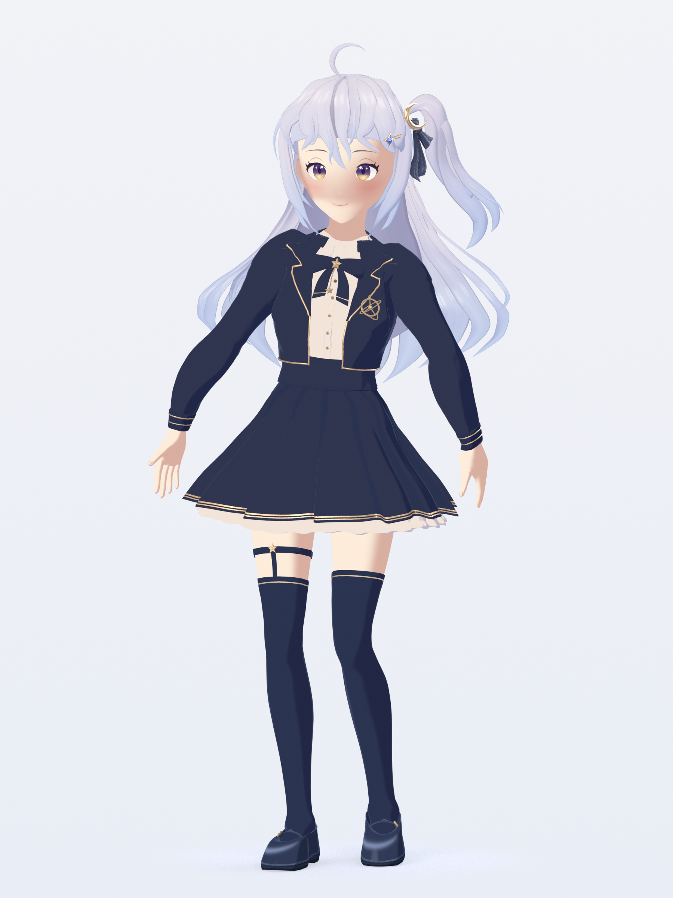

# 3D 二次元原创少女角色建模 — 星野 铃（Suzu Hoshino）

> **分支**：`feat/anime-girl-3d` · **状态**：**`GATE 3 FINAL PASSED`**
> **协作模式**：双 AI 纯原创 3D 角色生产与严审项目（遵循 `AGENTS.md` 与 `COLLAB_PLAYBOOK.md`）



## 项目概览

本项目从零设计并构建了一位现代日式二次元画风原创 3D 少女角色——**星野 铃（Suzu Hoshino）**，交付完整的生产级 3D 资产（`.blend` / `.glb`，183 绑定骨骼、57 原生表情、11.4s 内嵌连续表演动画）、高清英雄封面海报、1080p 360° 转盘与连续动作演示视频，以及纯离线 Three.js 交互式 3D Web 检视器。

## 快速打开 3D Web 检视器（纯离线）

```bash
python3 viewer/start.py
```

浏览器将自动打开 `http://127.0.0.1:8765/viewer/`（Windows 可直接双击 [`start-viewer.cmd`](start-viewer.cmd)）。支持 360° 自由旋转缩放、4 组镜头预设、着色/灰模/线框切换、4 组棚拍灯光、4 种原生表情 Morph Target 切换及 11.4s 连续动作播放与进度拖动。

## 最终交付物与核心文档

- **[`DELIVERY.md`](DELIVERY.md)** — 最终交付总览、全量资产 SHA-256 校验清单、本地启动与 Phase A→D 一键复现指南
- **[`assets/suzu_final.glb`](assets/suzu_final.glb)** / **[`assets/suzu_final.blend`](assets/suzu_final.blend)** — 终版生产级 3D 模型与贴图全打包 Blender 工程
- **[`previews/final/suzu_hero_render.png`](previews/final/suzu_hero_render.png)** — 终极高清英雄封面海报
- **[`previews/final/turntable_final_1080p.mp4`](previews/final/turntable_final_1080p.mp4)** / **[`previews/final/motion_final_1080p.mp4`](previews/final/motion_final_1080p.mp4)** — 1080p 30fps 360° 转盘与 11.4s 连续动作表情演示视频
- **[`previews/final/viewer_web_live.png`](previews/final/viewer_web_live.png)** / **[`previews/final/viewer_mobile_live.png`](previews/final/viewer_mobile_live.png)** — 桌面端与移动端实时 WebGL 检视器实拍图
- **[`USER_BRIEF.md`](USER_BRIEF.md)** — 视觉圣经、比例色板规范与 `Gate 1 → Gate 3` 门禁标准
- **[`references/`](references/)** — 导演原创三张跨视角对齐参考图（`01_hero_concept.jpg`、`02_turnaround_4view.jpg`、`03_face_expressions_props.jpg`）
- **[`REVIEW_LOG.md`](REVIEW_LOG.md)** — 艺术总监 8 轮全链路零文案盲审与签收日志（`Round 0.5 → Round 8 FINAL PASSED`）
- **[`CREDITS.md`](CREDITS.md)** — 开源基底与依赖许可声明（VRM Public License 1.0 / CC0 1.0 / MIT）
- **[`DEV_STATUS.md`](DEV_STATUS.md)** — 编码 / 3D 生产 AI（`6.2astra`）最终工程与复现说明
